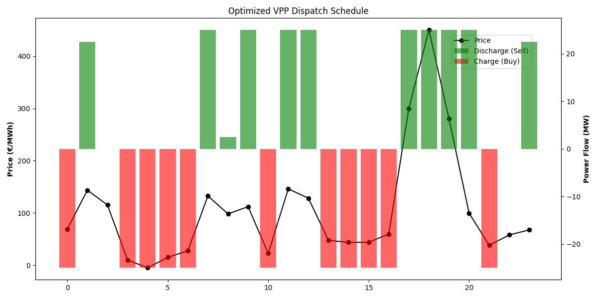

# Virtual Power Plant (VPP): Stochastic Dispatch Optimizer

## Executive Summary
In the highly volatile European power markets, the ability to instantly translate meteorological data into profitable trading action is a distinct competitive advantage. This repository serves as a commercially viable, end-to-end quantitative pipeline. **By deploying this architecture, a trading desk can generate instantaneous, mathematically optimal battery dispatch schedules that maximize daily P&L while strictly adhering to physical asset constraints.**

This project bridges data engineering, machine learning, and advanced operations research, proving that theoretical mathematics can be deployed to capture real-world arbitrage spreads.

## Core Architecture & Commercial Value

### 1. Asynchronous Data Engineering
* **The Engine:** Engineered a high-throughput, event-driven data ingestion pipeline using `asyncio` and `aiohttp`. 
* **The Source:** The pipeline concurrently streams live, institutional-grade meteorological data (100m wind speed and Direct Normal Irradiance) directly from the **Open-Meteo API**.
* **The Value:** Eliminates CPU blocking, allowing the system to scale and ingest thousands of grid nodes simultaneously—a critical requirement for high-frequency algorithmic trading environments.

### 2. Predictive Forecasting (Champion vs. Challenger)
* **The Engine:** Built a rigorous Time-Series Cross-Validation engine to predict renewable energy yield availability, pitting a classical statistical baseline (Ridge Regression) against a Machine Learning ensemble (Random Forest).
* **The Value:** Refuses to apply "black-box" AI blindly. The pipeline mathematically proved that the **Random Forest Regressor** captures non-linear weather relationships better, crowning it the champion with a highly accurate 0.919 R² score.

### 3. MILP Stack Optimization (PuLP)
* **The Engine:** Formulated a Mixed-Integer Linear Programming (MILP) solver to mathematically dictate the exact megawatt volume to charge or discharge at any given hour.
* **Commercial Realism & Constraints:** 
    * **Thermodynamic Efficiency:** Imposed a 90% round-trip efficiency penalty to simulate heat loss, preventing the solver from suggesting physically impossible simultaneous charge/discharge cycles.
    * **Cycle Aging (Degradation):** Injected a €5/MWh marginal penalty into the objective function. The model actively protects the physical asset, refusing to trade during low-volatility hours where the spread fails to cover the wear-and-tear of the lithium-ion cells.
    * **Bang-Bang Control:** Because the linear objective function contains no variable marginal costs, the algorithm intelligently slams the system to its absolute boundary constraints (25 MW max flow rate) to extract the maximum possible arbitrage spread.

## Optimization Visual

## Execution Guide
1. Run `python ingestion/async_pipeline.py` to test the concurrent Open-Meteo API network stream.
2. Run `python forecasting/ml_forecaster.py` to evaluate the Champion vs. Challenger model backtest.
3. Run `python optimization/milp_optimizer.py` to generate the optimal hourly dispatch schedule.